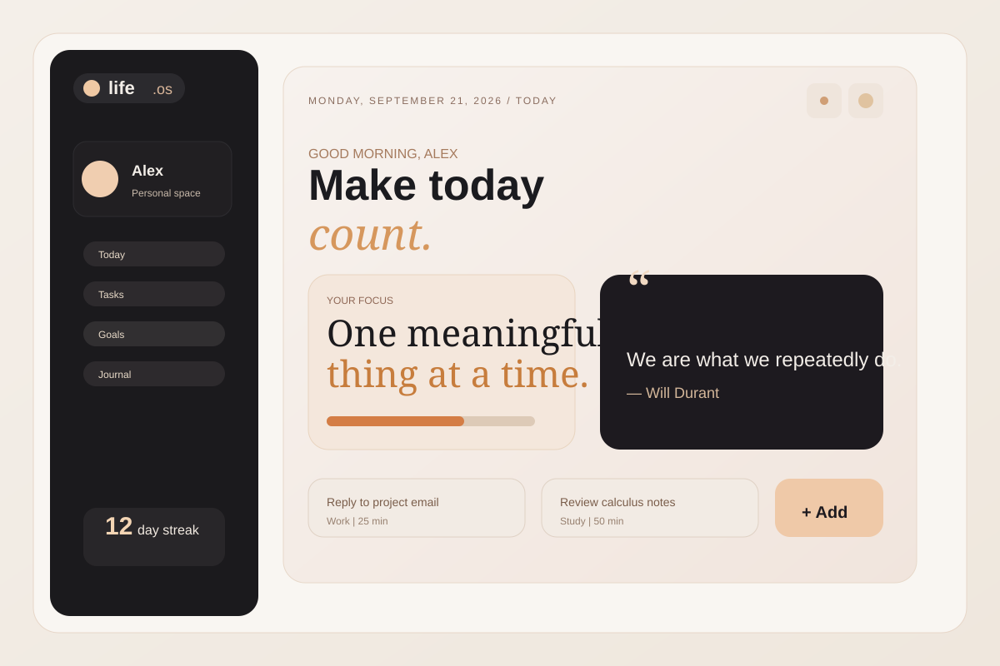
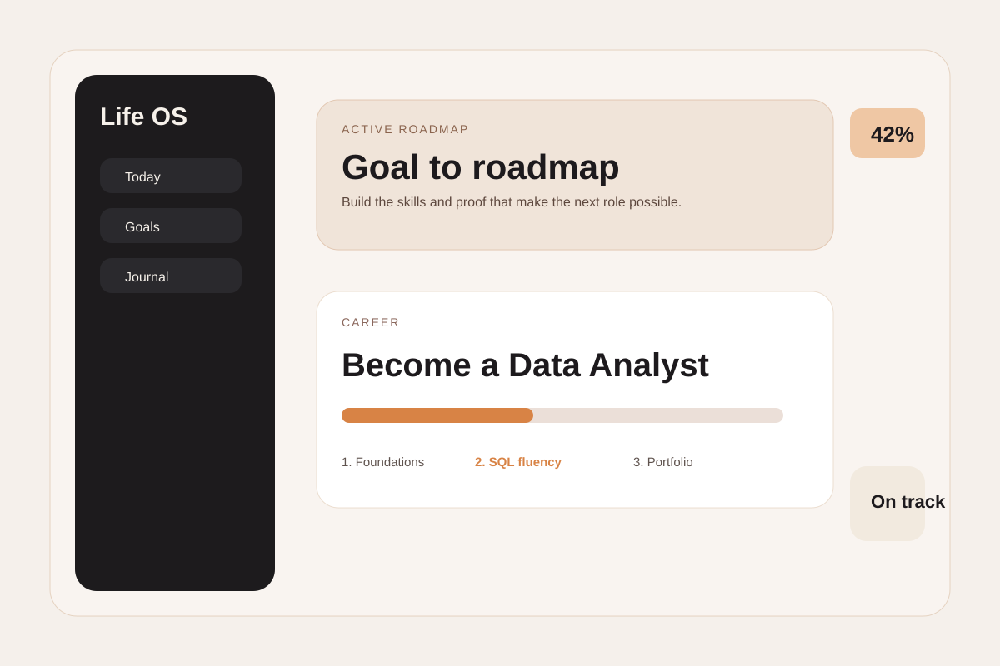
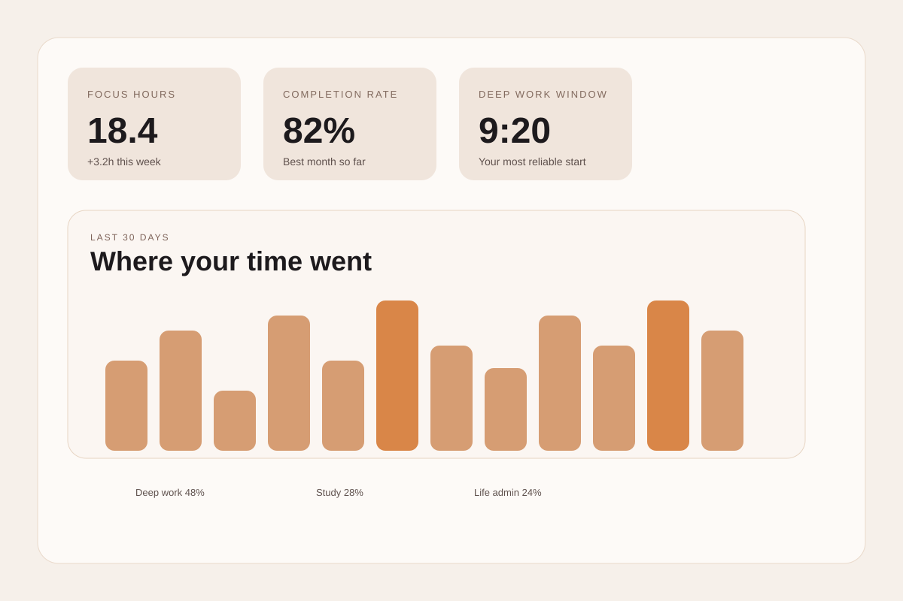

# Life OS

Life OS is a personal productivity dashboard designed to help you track tasks, goals, routines, decisions, and personal growth in one place. It combines a clean, modern interface with a practical daily planning system built in React and Vite.

## Features

- Daily focus dashboard with prioritized tasks
- Goal planning and milestone tracking
- Habit consistency tracking and streaks
- Journal and reflection prompts
- Memory capture for notes, ideas, and personal insights
- Personalized decision helper and what-if scenario planning
- Study mode and career roadmap management
- Document vault for important files and references
- Life timeline for milestones and progress over time
- Analytics and energy tracking for weekly and monthly patterns

## Tech stack

- React
- Vite
- JavaScript
- CSS custom styling

## Screenshots

### Dashboard overview



### Goals and roadmap view



### Analytics and focus insights



## Getting started

1. Install dependencies:
   ```bash
   npm install
   ```
2. Start the app in development mode:
   ```bash
   npm run dev
   ```
3. Build for production:
   ```bash
   npm run build
   ```

## Notes

This project is a lifestyle and productivity dashboard inspired by personal operating systems. It focuses on clarity, consistency, and self-improvement through better daily planning and reflection.
